# Mediroza Hospital – Web Application Penetration Testing

## Project Overview

This repository documents an authorized penetration testing exercise conducted against the intentionally vulnerable Mediroza Hospital training environment as part of a cybersecurity assessment organized by NetworkWalks.

The assessment focused on identifying and validating security weaknesses within the target's web application and externally observable infrastructure. Activities included domain reconnaissance, SQL injection testing, authentication bypass, password recovery of protected PDF documents, DNS enumeration, network scanning, and the discovery of an exposed SQL database backup.

The exercise provided practical experience in identifying vulnerabilities, validating their impact, analyzing exposed information, and developing appropriate remediation recommendations.

| Project Information | Details |
|---|---|
| Target | `https://medirozahospital.com` |
| Assessment Type | Authorized Web Application and Infrastructure Penetration Test |
| Environment | Intentionally Vulnerable Training Website |
| Training Organization | NetworkWalks |
| Assessment Period | 22 November 2026 – 27 November 2026 |
| Prepared By | Ahwen Israel Lutor Batch B084|
| Status | Assessment in Progress |

---

# 1. Assessment Objectives

The primary objectives were to:

- Conduct reconnaissance against the target domain and identify externally exposed services.
- Identify and test potential web application vulnerabilities.
- Evaluate authentication and access control mechanisms.
- Identify and investigate publicly accessible files and directories.
- Assess the security of password-protected documents.
- Identify sensitive information disclosure vulnerabilities.
- Evaluate the potential impact of discovered weaknesses.
- Document findings and provide practical remediation recommendations.

# 2. Scope

The primary target was:

`https://medirozahospital.com`

The assessment included examination of the website, publicly accessible resources, and DNS information associated with the domain.

**Resolved IP address:** `199.188.201.16`

**Reverse DNS hostname:** `server274-1.web-hosting.com`

The IP address appeared to be associated with a shared hosting environment. Consequently, observations concerning services on that IP address were treated cautiously and were not automatically attributed to the hospital's application.

All testing activities described in this repository were performed within the authorization and scope of the training exercise.

---

# 3. Methodology and Activities

## 3.1 Domain and DNS Reconnaissance

**Tools used:**
- WHOIS
- nslookup
- DNSRecon
- dnsenum

The initial phase involved gathering information about the target domain, registration details, DNS configuration, mail exchange infrastructure, and associated subdomains.

### Activities

**WHOIS Enumeration**

WHOIS was used to retrieve domain registration information, identify the registrar, and examine the domain's name server configuration.

**DNS Enumeration**

DNSRecon and dnsenum were used to identify DNS records, mail exchange servers, authoritative name servers, and discoverable subdomains.

**DNS Zone Transfer Testing**

Zone transfer requests were attempted against both identified authoritative name servers.

Both requests returned `REFUSED`, indicating that the attempted transfers were not permitted.

### Key Observations

- Registrar: Namecheap
- Domain IP: `199.188.201.16`
- Authoritative name servers:
  - `dns1.namecheaphosting.com`
  - `dns2.namecheaphosting.com`
- DNSSEC was reported as unsigned.
- DMARC was configured with a monitoring-only policy (`p=none`).
- SPF used a soft-fail mechanism (`~all`).

Subdomains identified:

- `autodiscover.medirozahospital.com`
- `ftp.medirozahospital.com`
- `mail.medirozahospital.com`
- `webmail.medirozahospital.com`
- `www.medirozahospital.com`

### Screenshots

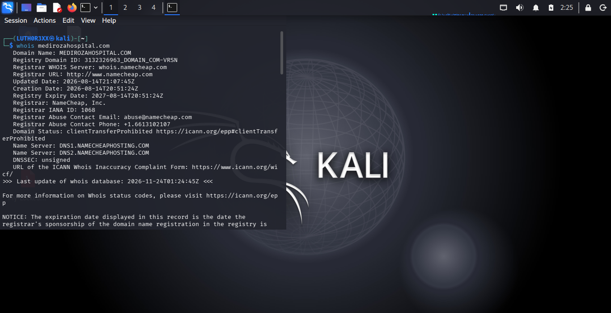

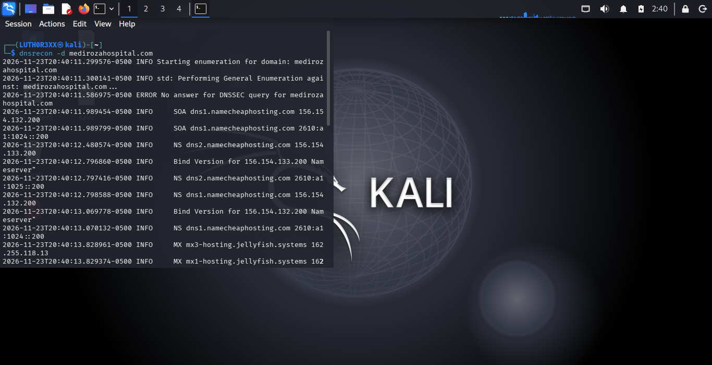

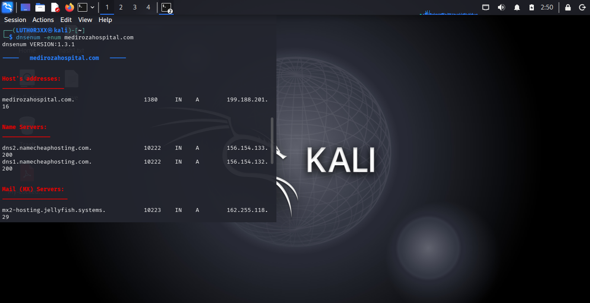

---

## 3.2 Web Technology Identification

**Tool used:** WhatWeb

WhatWeb was used to identify technologies and server information exposed through the target website's HTTP and HTTPS responses.

### Observations

Both HTTP and HTTPS requests returned an HTTP 200 response. However, automated requests encountered a verification page displaying:

`One moment, please...`

The responses exposed the following information:

| Attribute | Observation |
|---|---|
| IP Address | `199.188.201.16` |
| Server | OpenResty 1.31.1.1 |
| HTML Standard | HTML5 |
| Content-Security-Policy | Present |
| X-Frame-Options | SAMEORIGIN |
| X-Content-Type-Options | Present |
| Referrer-Policy | Present |

The verification page limited the ability to identify the underlying application technology stack through automated fingerprinting.

### Screenshots

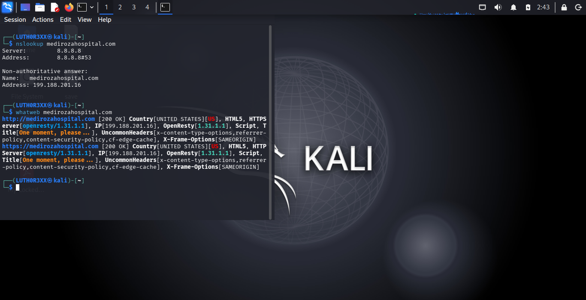

---

## 3.3 Network and Service Enumeration

**Tool used:** Nmap

Nmap was used to identify externally accessible ports and obtain preliminary service and version information.

### Initial Scan

| Port | Service | State |
|---|---|---|
| 22 | SSH | Filtered |
| 53 | DNS | Filtered |
| 80 | HTTP | Open |
| 443 | HTTPS | Open |

### Service Detection

A subsequent service detection scan identified additional services.

| Port | Service | Detected Software |
|---|---|---|
| 21 | FTP | Pure-FTPd |
| 25 | SMTP | SMTP proxy |
| 26 | SMTP | Exim 4.100.1 |
| 53 | DNS | BIND |
| 80 | HTTP | HAProxy |
| 110 | POP3 | Dovecot |
| 143 | IMAP | Dovecot |
| 179 | TCP | tcpwrapped |
| 443 | HTTPS | HAProxy |
| 465 | SMTPS | Exim 4.100.1 |
| 587 | SMTP Submission | Exim 4.100.1 |
| 993 | IMAPS | Dovecot |
| 995 | POP3S | Dovecot |
| 2196 | HTTPS | HAProxy |
| 8888 | HTTP | LiteSpeed |

### Analysis

The scan revealed services associated with web hosting, email communication, and DNS resolution.

The reverse DNS hostname suggested that the target was operating within a shared hosting environment. This was considered when interpreting results and determining which observations could reasonably be attributed to the target application.

### Screenshots

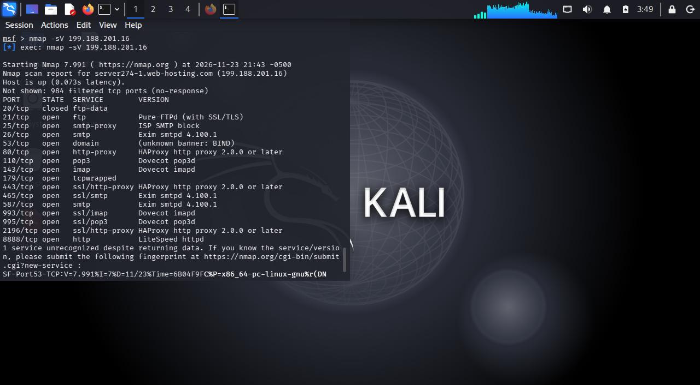

---

# 4. Vulnerability Assessment and Findings

## 4.1 SQL Injection – Patient Login Authentication Bypass

**Vulnerability:** SQL Injection  
**Affected Resource:** `/patient/login.php`  
**Demonstrated Destination:** `/portal.php`  
**Severity:** High – Provisional

### Discovery and Initial Testing

During the examination of the patient login functionality, an SQL injection test was performed by supplying a specially crafted input in the username field.

The initial test involved entering:

`administrator'`

The application returned a SQL syntax error.

This response suggested that user-supplied input was being incorporated into a database query without adequate handling. Although a syntax error alone does not conclusively establish SQL injection, it provided an indication that the application's query construction required further examination.

### Validation

Further testing involved attempting SQL comment syntax to alter the behaviour of the authentication query.

The following input was eventually successful:

`admin'-- `

The application accepted the input and granted access to `/portal.php` without the normal password authentication process.

This demonstrated that the login functionality was vulnerable to SQL injection and that the authentication mechanism could be bypassed.

### Technical Analysis

SQL injection occurs when an application incorporates untrusted user input directly into an SQL statement without appropriate parameterization.

In this instance, the input manipulation affected the authentication query, allowing the remainder of the intended password-checking logic to be commented out.

The successful authentication bypass demonstrated that the application did not adequately separate user input from executable SQL instructions.

### Security Impact

- Bypass of the patient portal's normal authentication process.
- Unauthorised access to the patient dashboard.
- Potential exposure of patient-related functionality and information accessible through the dashboard.
- Possible compromise of patient account confidentiality, depending on the permissions and data accessible after authentication bypass.

### Recommended Remediation

1. Replace dynamically constructed SQL statements with parameterized queries and prepared statements.
2. Avoid concatenating user-supplied input directly into database queries.
3. Apply server-side input validation.
4. Restrict database account privileges according to the principle of least privilege.
5. Implement secure authentication and session management.
6. Avoid exposing detailed database errors to end users.
7. Conduct additional SQL injection testing across other database-backed application functions.

### Screenshots

<!-- Insert sanitized evidence of the SQL error and successful authentication bypass. Do not expose patient records or session credentials. -->

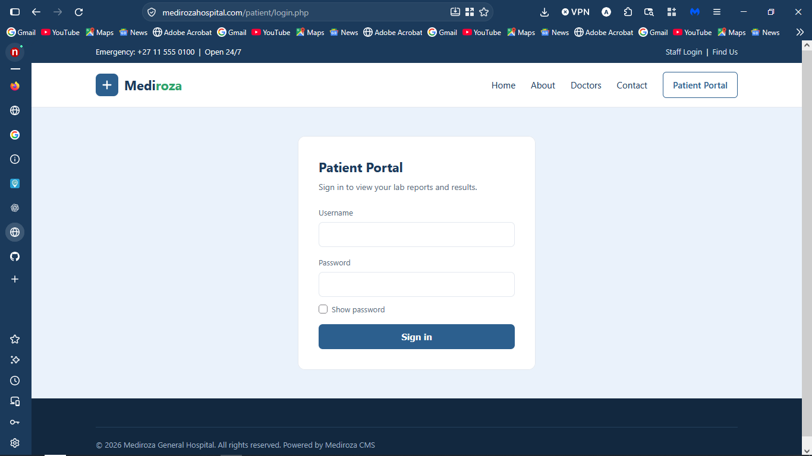

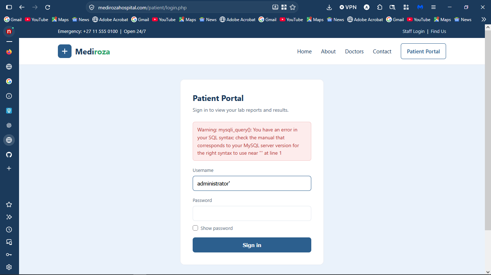

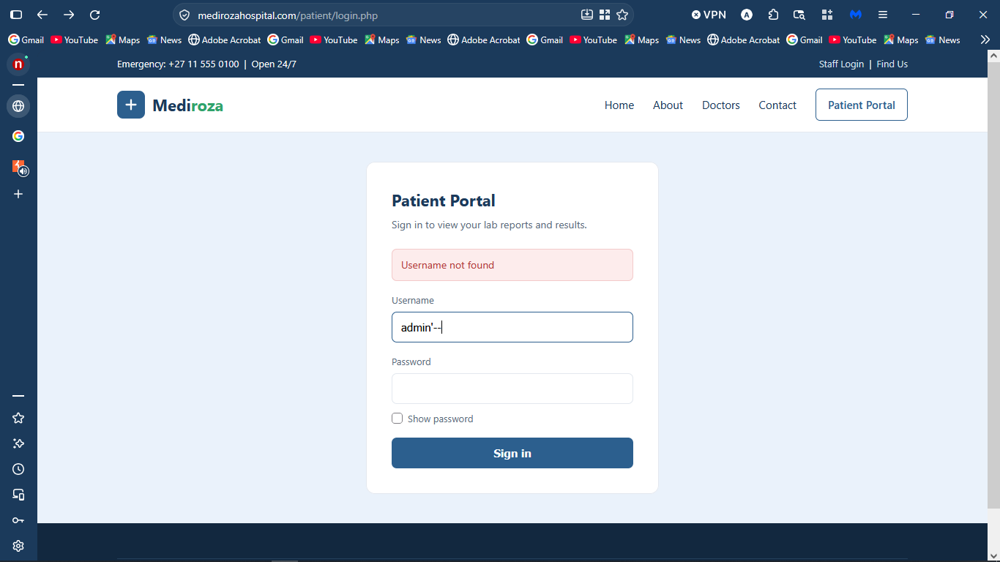

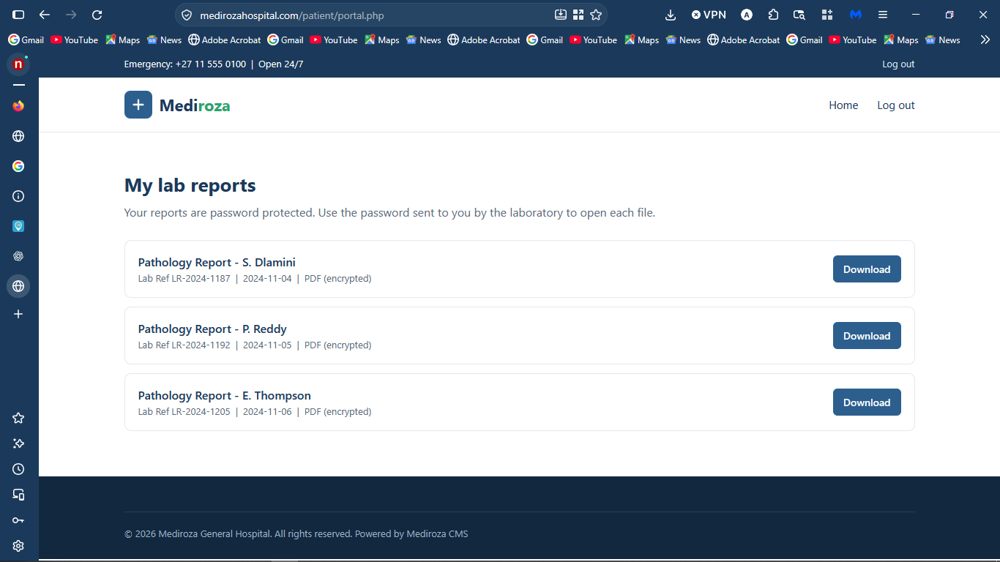

---

## 4.2 Password Recovery – Protected PDF Documents

**Tools used:**
- OnlineHashCrack
- John the Ripper (JtR)

**Affected Resources:** Three password-protected PDF documents  
**Severity:** Medium – Provisional, subject to document sensitivity and protection details

### Discovery and Assessment

During the assessment, three password-protected PDF documents were discovered.

The documents were subjected to password recovery using OnlineHashCrack and John the Ripper.

All three passwords were successfully recovered, allowing the documents to be opened and their contents inspected within the authorized scope of the exercise.

The passwords used to protect the documents were found to be weak and easily recoverable.

### Security Impact

The successful recovery demonstrated that the password protection applied to the documents did not provide an effective security barrier against the techniques used during the exercise.

The documents contained patient-related information, making the weakness particularly relevant to confidentiality.

An attacker obtaining similarly protected documents could potentially recover their passwords and access information intended to remain confidential.

### Recommended Remediation

- Use strong, unique, randomly generated passwords for sensitive documents.
- Apply appropriate encryption to confidential documents.
- Avoid using common words, predictable numeric sequences, or easily guessed character patterns as passwords.
- Store sensitive documents in access-controlled locations.
- Avoid relying on document passwords as the sole security control.
- Review document creation, storage, and distribution procedures.

### Screenshots


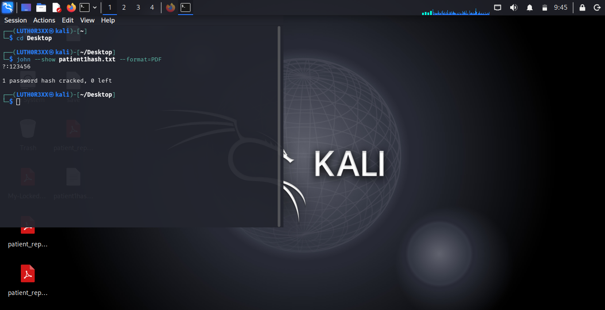

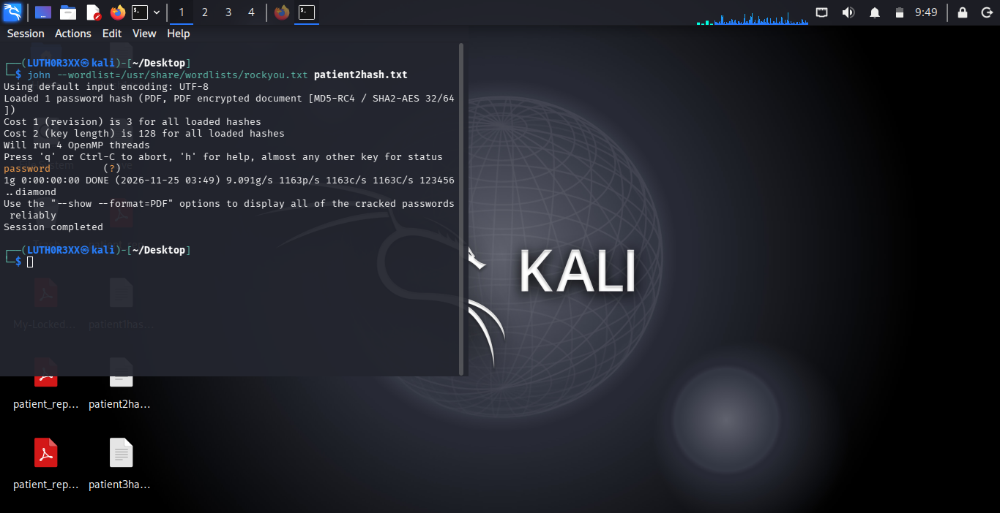

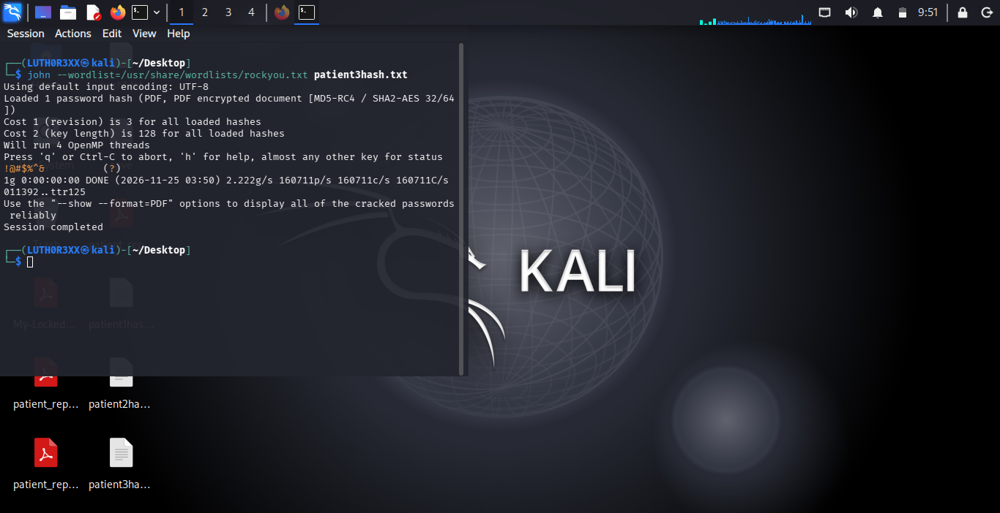

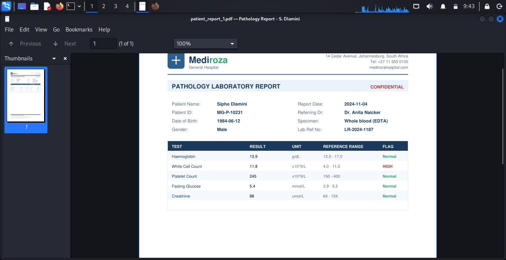

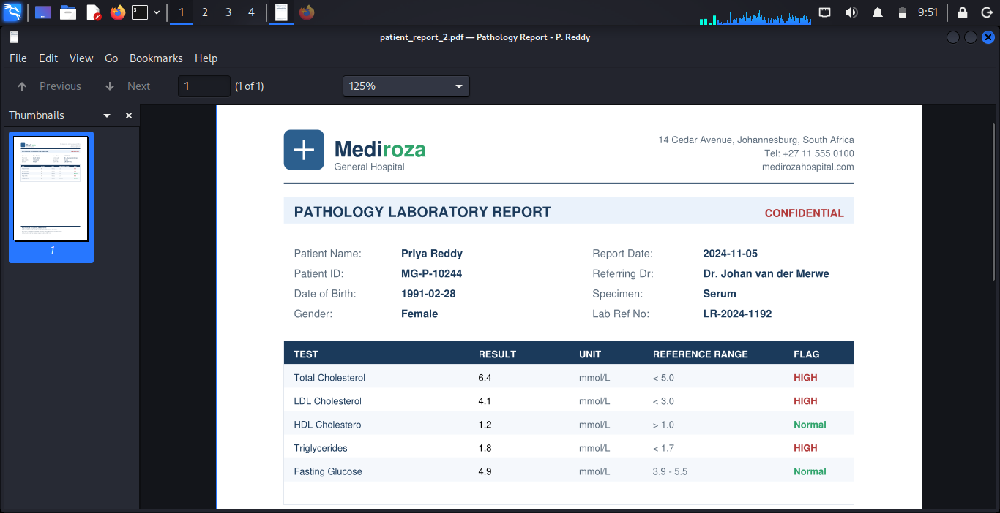

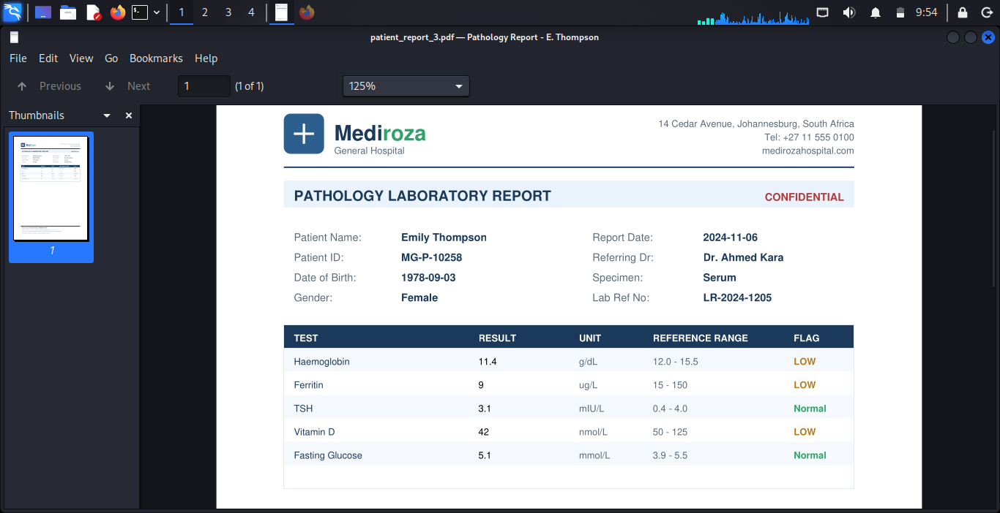

---

## 4.3 Publicly Accessible SQL Database Backup

**Vulnerability:** Sensitive Information Disclosure  
**Affected Resource:** `/old/`  
**File:** `mediroza_db_backup_2019.sql`  
**Severity:** High – Provisional

### Discovery

During web reconnaissance, the website's `robots.txt` file was inspected to identify directories excluded from search engine crawling.

The file contained an entry disallowing crawlers from accessing the `/old` directory.

The directory was subsequently examined within the authorized scope of the training exercise.

It contained a single SQL database backup file.

### Validation

The SQL file was accessible through a standard web browser without authentication.

The database backup was inspected as permitted by the exercise, and its contents included staff and shareholder information.

This confirmed that sensitive organizational information was stored in a database backup accessible through the public web environment.

### Extracted Database Information

**Source:** `mediroza_db_backup_2019.sql`  
**Extraction date:** 26 November 2026  
**Evidence source:** Two screenshots

The database contained the following categories of information:

| Data Category | Records / Details Identified |
|---|---|
| Staff records | 30 |
| Shareholder records | 10 |
| Employee names | Present |
| Job titles and departments | Present |
| Email addresses and telephone numbers | Present |
| National identification numbers | Present |
| Monthly salary information | Present |
| Employment start dates | Present |
| Shareholder ownership percentages | Present |
| Share quantities and share classes | Present |

### Shareholder Data Summary

The shareholder records identified in the backup accounted for:

- Total shareholder ownership: 100%.
- Total shares: 1,000,000.
- Number of shareholder entries: 10.

The backup therefore exposed not only personal and employment information but also information relating to the organization's ownership structure.

### Security Impact

The exposure of this database backup could allow unauthorized individuals to retrieve sensitive personal, employment, and organizational information without interacting with the application's normal authentication mechanisms.

Potential consequences include:

- Disclosure of personally identifiable information.
- Identity-related fraud.
- Targeted phishing and social engineering.
- Exposure of employee compensation and organizational structure.
- Disclosure of shareholder and ownership information.
- Further attacks if authentication-related information is also present in the backup.
- Reputational and regulatory consequences.

### Recommended Remediation

1. Remove database backups from publicly accessible directories.
2. Store backups outside the web root in appropriately protected storage.
3. Implement access controls to prevent unauthorized retrieval.
4. Review web server access logs for evidence of previous access.
5. Search other directories for exposed database exports, archives, and configuration files.
6. Establish a secure backup retention and disposal policy.
7. Assess whether the exposed information requires further incident response.

### Screenshots


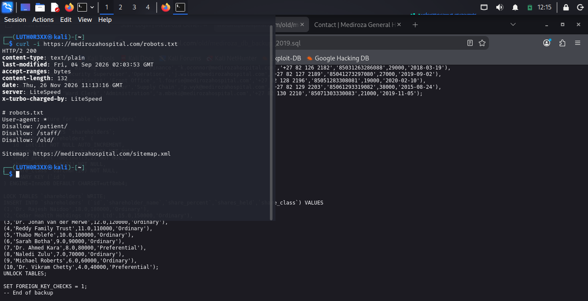

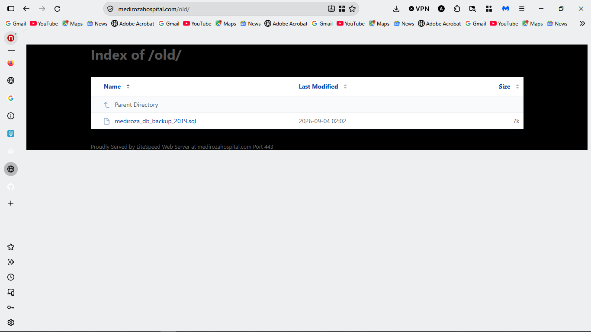

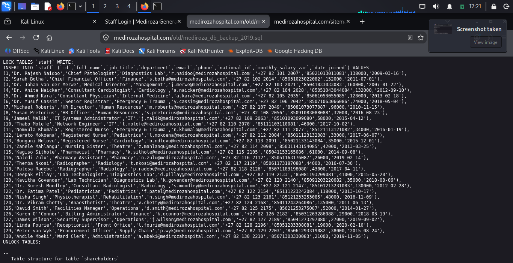

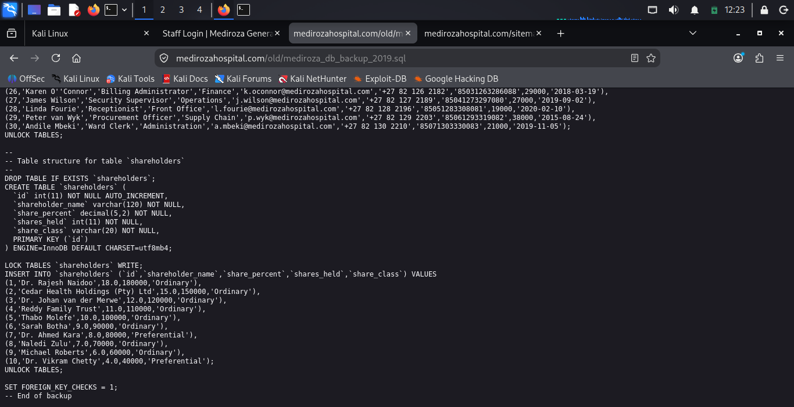

---

## 4.4 FTP Service Assessment

**Service:** Pure-FTPd – TCP Port 21

### FTP Banner

The server identified itself as Pure-FTPd and advertised TLS support.

The banner explicitly stated:

`This is a private system - No anonymous login`

### TLS Assessment

OpenSSL was used to establish an FTP connection secured with TLS.

The connection successfully negotiated:

| Attribute | Result |
|---|---|
| TLS Version | TLS 1.3 |
| Cipher Suite | TLS_AES_256_GCM_SHA384 |
| Key Exchange | X25519 |
| Certificate Key | RSA 2048-bit |
| Certificate Verification | Successful |
| Certificate Common Name | `*.web-hosting.com` |

### Analysis

The FTP service advertised that anonymous authentication was disabled.

The successful TLS 1.3 negotiation demonstrated support for a modern encryption protocol. However, the certificate's intended hostname identity requires further validation because the initial connection was made directly to the IP address.

No FTP vulnerability was confirmed from the observations available at this stage.


---

# 5. Consolidated Findings and Risk Assessment

| ID | Finding | Risk Assessment | Status |
|---|---|---|---|
| F-01 | SQL Injection resulting in patient portal authentication bypass | High – Provisional | Confirmed |
| F-02 | Weak passwords protecting three PDF documents containing patient-related information | Medium – Provisional | Password recovery successful |
| F-03 | Publicly accessible SQL database backup containing staff and shareholder information | High – Provisional | Confirmed |
| O-01 | DNSSEC not enabled | Informational / Hardening | Observed |
| O-02 | DMARC policy configured as `p=none` | Low / Hardening | Observed |
| O-03 | SPF record uses soft-fail policy | Informational / Hardening | Observed |
| O-04 | FTP service exposed on TCP 21 | Informational | Observed |
| O-05 | FTP supports TLS 1.3 | Positive security observation | Observed |
| O-06 | DNS zone transfer requests refused | Positive security observation | Confirmed |
| O-07 | Multiple email-related services exposed on the hosting IP | Informational | Observed |
| O-08 | Automated web technology identification limited by verification page | Assessment limitation | Observed |

*Severity ratings are provisional and should be finalized following assessment of exploitability, information sensitivity, and business impact.*

---

# 6. Skills Demonstrated

### Reconnaissance and Information Gathering
- Domain and DNS enumeration.
- WHOIS analysis.
- Subdomain discovery.
- Network and service enumeration.

### Web Application Security
- SQL injection identification and validation.
- Authentication bypass testing.
- Analysis of application access controls.
- Identification of sensitive information exposure.

### Password Security
- Password recovery using OnlineHashCrack.
- Password recovery using John the Ripper.
- Assessment of password-protected PDF documents.
- Evaluation of weak password practices.

### Infrastructure Security
- Nmap service detection.
- FTP service assessment.
- TLS negotiation and certificate examination.
- DNS and email security configuration review.

### Security Reporting
- Technical evidence collection.
- Vulnerability classification.
- Risk assessment.
- Remediation recommendations.
- Technical documentation.

---

# 7. Tools and Technologies

| Tool | Application |
|---|---|
| Kali Linux | Penetration testing environment |
| WHOIS | Domain registration reconnaissance |
| nslookup | DNS resolution |
| DNSRecon | DNS enumeration |
| dnsenum | DNS and subdomain enumeration |
| Nmap | Network scanning and service identification |
| WhatWeb | Web technology fingerprinting |
| cURL | HTTP request and response inspection |
| Web Browser | Manual web application testing |
| OnlineHashCrack | PDF password recovery |
| John the Ripper | Password recovery |
| OpenSSL | TLS connection and certificate analysis |

---

# 8. Conclusion

This assessment provided practical experience across multiple stages of a penetration testing engagement, from initial reconnaissance to the identification and validation of application-level and information disclosure vulnerabilities.

The assessment identified an SQL injection vulnerability in the patient login functionality that allowed authentication bypass and access to the patient portal.

Further testing identified three password-protected PDF documents containing patient-related information. Their weak passwords were successfully recovered using OnlineHashCrack and John the Ripper.

The assessment also uncovered a publicly accessible SQL database backup containing 30 staff records and 10 shareholder records, exposing personal, employment, and ownership-related information.

These discoveries demonstrate how weaknesses in application input handling, password practices, and backup storage can undermine the confidentiality of sensitive organizational information.

Beyond identifying vulnerabilities, the exercise strengthened practical skills in reconnaissance, web application testing, password security assessment, service enumeration, evidence collection, risk analysis, and technical reporting.

The project reinforces the importance of a structured security assessment process and the need to evaluate vulnerabilities in terms of their actual security implications rather than relying solely on automated tool output.

---

# 9. Repository Structure

```text
mediroza_hospital_pentest/
│
├── README.md
│
├── screenshots/
│   ├── whois.png
│   ├── dnsrecon.png
│   ├── dnsenum.png
│   ├── whatweb.png
│   ├── nmap-services.png
│   ├── patient-login.png
│   ├── sql-error.png
│   ├── sql-injection-validation.png
│   ├── portal-access.png
│   ├── pdf-hash-unlock.png
│   ├── JtR1.png
|   ├── JtR2.png
|   ├── JtR3.png
│   ├── pdf-access1.png
|   ├── pdf-access2.png
|   ├── pdf-access3.png
│   ├── robots-txt.png
│   ├── old-directory.png
│   ├── sql-backup-access1.png
│   ├── sql-backup-access2.png
│   
└── reports/
    └── final_pentest_report.pdf
```

---

# 10. Disclaimer

This repository documents an authorized cybersecurity training exercise conducted against an intentionally vulnerable environment provided for educational assessment by NetworkWalks.

All testing activities were performed within the exercise's authorized scope.

No actual patient records, employee personal information, national identification numbers, confidential database contents, recovered passwords, password hashes, or protected PDF documents are included in this repository.

The findings are presented for educational and defensive security purposes.
