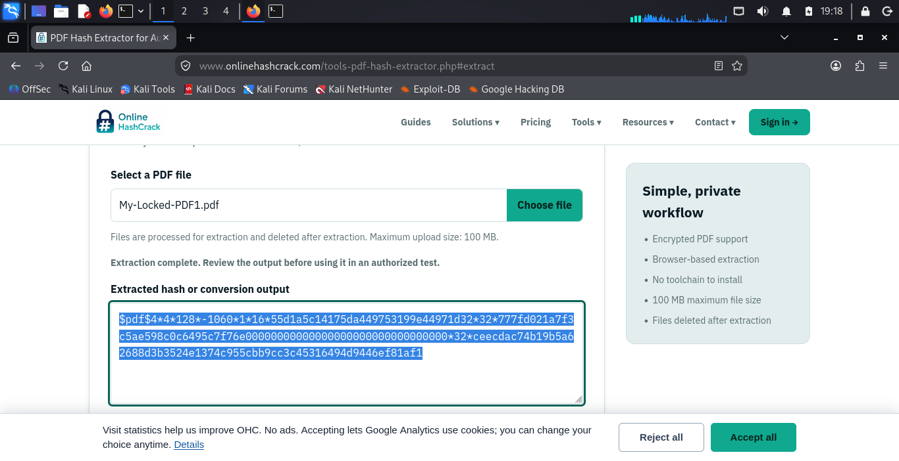
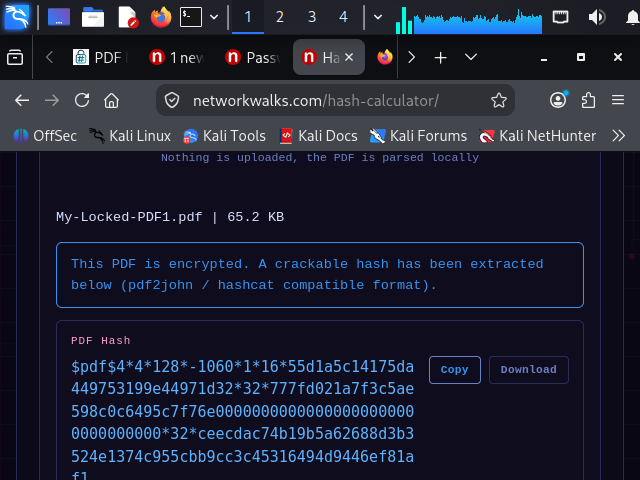
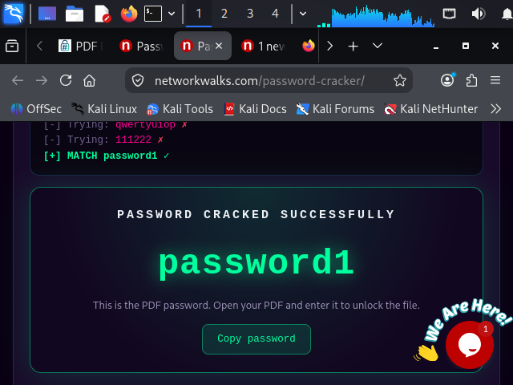

# Password Cracking and Recovery exercise 

## Overview

This project documents a practical exercise involving the recovery of passwords from a password-protected PDF document using two different approaches:

1. John the Ripper (JtR) on Kali Linux.
2. NetworkWalks online Hash Calculator and Password Cracker.

The exercise explored PDF hash extraction, dictionary-based password attacks, and password recovery verification.

## Objectives

- Understand how password-protected PDF files can be assessed through their password hashes.
- Practice extracting password hashes from PDF documents.
- Perform dictionary-based password attacks using John the Ripper.
- Explore online hash extraction and password recovery utilities.
- Verify recovered passwords by accessing the protected document.

## Tools and Technologies

| Tool | Purpose |
|---|---|
| Kali Linux | Penetration testing environment |
| John the Ripper | Password-cracking utility |
| RockYou Wordlist | Dictionary containing candidate passwords |
| OnlineHashCrack PDF Hash Extractor | Extracting PDF password hashes |
| NetworkWalks Hash Calculator | Extracting PDF password hashes |
| NetworkWalks Password Cracker | Recovering passwords from extracted hashes |

---

## Task 1: PDF Password Cracking with John the Ripper

### Methodology

**1. Preparing the wordlist**

Kali Linux includes the RockYou wordlist in compressed form. The archive was extracted using:

```bash
sudo gzip -d /usr/share/wordlists/rockyou.txt.gz
```

This produced the uncompressed `rockyou.txt` dictionary, which was subsequently used by John the Ripper during the dictionary attack.

**2. Extracting the PDF hash**

The password-protected PDF was uploaded to the [OnlineHashCrack PDF Hash Extractor](https://www.onlinehashcrack.com/tools-pdf-hash-extractor.php).

The extracted hash was copied and saved in a text file named `hash1.txt`.


**2. Extracting the PDF hash**

The password-protected PDF was uploaded to the [OnlineHashCrack PDF Hash Extractor](https://www.onlinehashcrack.com/tools-pdf-hash-extractor.php).

The extracted hash was copied and saved in a text file named `hash1.txt`.

**3. Executing the dictionary attack**

John the Ripper was executed with the RockYou wordlist:

```bash
john --wordlist=/usr/share/wordlists/rockyou.txt hash1.txt
```

John successfully identified the hash format automatically and proceeded to test password candidates from the supplied wordlist.

**4. Password recovery and verification**

The dictionary attack successfully recovered the PDF password:

`password1`

This was confirmed using:

`john --show hash1.txt --format=PDF`

The recovered password was entered into the PDF reader, successfully granting access to the protected document.

### Screenshots

**PDF Hash Extraction**




**John the Ripper Command and Execution**


**Successful Password Recovery**


**PDF Successfully Opened**


---

## Task 2: PDF Password Recovery Using NetworkWalks Tools

### Methodology

This task involved using two online utilities provided by NetworkWalks to extract the PDF hash and recover its corresponding password.

**1. Hash extraction**

The password-protected PDF was uploaded to the NetworkWalks Hash Calculator, which extracted its password hash.

**2. Password cracking**

The extracted hash was copied into the NetworkWalks Password Cracker. The tool successfully recovered the password associated with the PDF.

**3. Password verification**

The recovered password was entered into the PDF reader, successfully opening the previously protected document.

### Screenshots

**NetworkWalks Hash Calculator**




**NetworkWalks Password Cracker**



**Successful PDF Access**


---

## Results and Observations

Both approaches successfully recovered the password required to access the protected PDF document.

The John the Ripper exercise demonstrated the practical application of dictionary-based password attacks using a locally available wordlist. It also provided experience with PDF hash extraction and automatic hash-format identification.

The NetworkWalks exercise demonstrated an alternative workflow using online utilities to extract password hashes and recover passwords without manually executing a password-cracking command.

The recovered password was successfully verified by opening the protected PDF.

## Skills Demonstrated

- Linux command-line operations.
- Password hash extraction and handling.
- Dictionary-based password attacks.
- Practical use of John the Ripper.
- Hash-format identification.
- Use of online password recovery utilities.
- Password recovery verification.
- Understanding of PDF password protection mechanisms.

## Conclusion

This exercise provided practical exposure to two approaches to PDF password recovery, reinforcing the relationship between password hashes, candidate password testing, and successful authentication.

It also strengthened familiarity with password-auditing tools and demonstrated the importance of understanding both command-line and web-based security utilities.

*All activities were performed as part of Week 3 of NetworkWalks authorized cybersecurity internship exercise.*
# Author
Ahwen Israel Lutor | NetworkWalks Batch B084E
